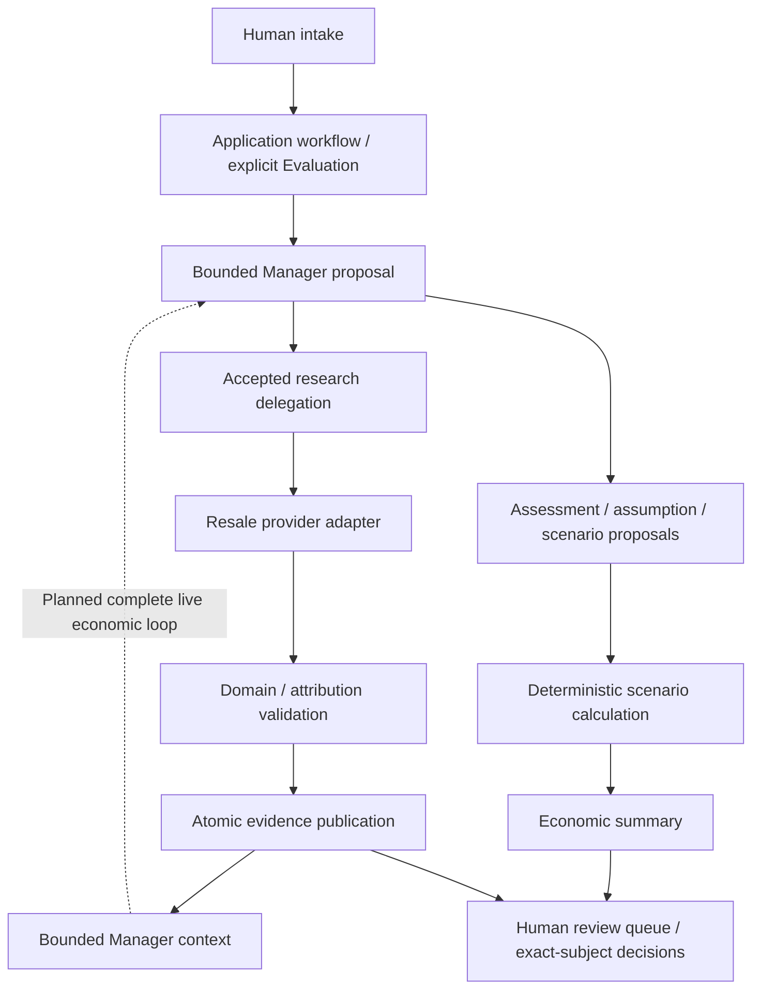

# AI Arbitrage Agent Project

**PROJECT STATUS: PAUSED BY USER — 2026-11-08.** Not abandoned; not production-ready.
No autonomous purchases, stocking, listings, sales or other commercial actions are authorized.
This status is documentation only, not a runtime pause mechanism.

Start here, then read [Current status and roadmap](docs/CURRENT_STATUS.md) and
[Resumption guide](docs/RESUMPTION_GUIDE.md). Detailed historical implementation
notes remain in [V2 architecture/checkpoint history](arbitrage/v2/README.md).
[Database/launcher guidance](V2_DEVELOPMENT.md) explains the legacy entry point.

## Purpose and authority

Build a human-supervised multi-agent system to research and evaluate potential
resale/arbitrage opportunities, while learning agent orchestration, tools,
persistence, validation and human oversight. Intended users are a human operator
researching possible acquisitions and developers maintaining the learning system.
The goal is supportable judgments, including insufficient-information outcomes,
not manufacturing profitable opportunities.

Agents research products and markets and propose qualitative/economic judgments.
Deterministic Python owns validation, exact provenance, arithmetic, bounded
execution, persistence and replay safety. Humans assess opportunities and retain
final authority. A model assertion, accepted schema, source URL or human report
does not independently establish a marketplace fact.

The intended V2 flow is intake → research → comparable assessment → explicit
assumptions/scenarios → deterministic calculations → economic summary → human
review. Components exist and are tested offline; the complete live economic
workflow is **not** integrated or demonstrated. Live Manager and Resale calls
have only been exercised in bounded, separately authorized diagnostics.

## Architectural evolution

- **V1 learning system:** general Assistant, date/time/tip/weather tools, Travel
  handoff, Budget/Travel agent-tools, then web-enabled Sourcing and Resale.
  SQLiteSession retained conversations; RunConfig organized hosted traces.
- **V1C:** Candidate/Evaluation lifecycle, typed evidence, application-owned cost
  capture, authoritative profitability assembly, identity/provenance safeguards
  and recovery. Complex strict-output failures prompted controlled diagnostic
  experiments and a text/action boundary conversion. Git preserves both the
  experiments and the later tested text baseline; see the history and diagnostic
  tests rather than assuming every historical experiment still applies.
- **V2 pivot:** strict identity/completeness gates frequently obstructed useful
  conditional economic evaluation of imperfect real-world leads. The principle
  is **RECORD BROADLY. REVIEW BROADLY. FILTER LATER.** Missing evidence is retained
  and disclosed, not ignored or automatically promoted to a fact. Economic
  judgment is separate from computation status, workflow progress and review.

Preserved V1C branch: `v1c-from-text-baseline` at
`9201167ae58bf040b07f4f02a057f26c0e98ca64`.
Confirmed stable `main`: `1bda31365f64d3a0c0c1844ef0aee5bd9122d0be`.
Current V2 implementation baseline: `05360e9c43da4023eaf5920398e781f3921d7b6b`
on `v2-human-review` (the pause documentation commit follows it).

V1C retains six active roles: Lead Qualifier, Arbitrage Manager, Sourcing,
Resale, Acquisition Capture and Selling Capture. Intake creates durable Candidates;
Sourcing supplies text reports; Resale supplies structured evidence. Dedicated
application-owned capture agents record acquisition/selling economics after
research. Profitability uses authoritative persisted evidence and deterministic
arithmetic. Identity resolution, shipping-cost coverage, explicit human Evaluation
selection/reattachment, bounded recovery and context reconstruction remain in the
legacy modules. Travel/Budget/demo implementations are retained learning examples,
not the active arbitrage workflow. No V1C work is changed by this handoff.

## V2 component map

Solid economic paths describe implemented APIs/offline capabilities, not proof
that the live Manager has completed all these steps together.

| Concern | Current code |
| --- | --- |
| Frozen typed contracts, distinct status dimensions | [contracts.py](arbitrage/v2/contracts.py) |
| Explicit Opportunity/Evaluation storage, append-only artifacts/revisions, exact IDs/sequences, atomic receipts | [persistence.py](arbitrage/v2/persistence.py) |
| Bounded steps/attempts, durable manifests, explicit restart reconciliation | [workflow.py](arbitrage/v2/workflow.py) |
| Context authority, stale-context rejection, five proposal intents | [manager.py](arbitrage/v2/manager.py) |
| One-call strict Manager transport and audit | [live_manager.py](arbitrage/v2/live_manager.py) |
| Accepted-decision delegation and atomic Resale publication | [resale_delegation.py](arbitrage/v2/resale_delegation.py) |
| Offline specialist boundary / live web-search adapter | [resale.py](arbitrage/v2/resale.py), [live_resale.py](arbitrage/v2/live_resale.py) |
| Durable provider stages, hashes, budgets | [resale_audit.py](arbitrage/v2/resale_audit.py) |
| Explicit scenario mapping into unchanged deterministic engine | [economics.py](arbitrage/v2/economics.py), [engine](arbitrage/tools/profitability.py) |
| Human assessment-only service, current-subject review | [review.py](arbitrage/v2/review.py) |

Persistence uses V2-specific SQLite tables and schema version 1, explicit isolated
paths, append-only artifacts and operation receipts. Exact references preserve
Evaluation ownership and revision sequence. Idempotent replay returns recorded
receipts; changed requests cannot reuse a key. Reviews remain linked to exact
subjects; new evidence may make an earlier review non-current. SQLite transactions
protect writes, but are not distributed worker leases or tamper-proof storage.
SDK conversation sessions and provider/SDK tracing are separate from business
evidence. V2 provider audits are durable local records, not a replacement for
independent source verification.

## Economic states are not interchangeable

- `EVIDENCE_BASED_ESTIMATE`: authored assessment supported by identified evidence,
  with its limits; not a claim of independently verified profit.
- `CONDITIONAL_ESTIMATE`: explicit assumptions and consequential uncertainties
  underpin a scenario. Assumptions retain provenance and cannot become facts.
- `INSUFFICIENT_INFORMATION`: a legitimate reviewable judgment when support is inadequate.

Known/unknown inputs, assumption origins, material uncertainty, source references
and limitations are represented explicitly. Scenario inputs distinguish evidence,
assumptions, unknowns and coverage relationships. The adapter rejects unsupported
currency/quantity/fee semantics rather than inventing inputs. It invokes the
existing engine without changing percentage or per-batch arithmetic.

Calculation status is separately `CALCULATED`, `INSUFFICIENT_INPUTS`,
`INVALID_INPUTS` or `ERROR`. Execution state is separately `RUNNING`, `FINISHED`,
`PARTIAL`, `FAILED` or `CANCELLED`. Review currentness/queue status is separate
again: `PENDING` does not imply an economic rejection. Manager judgment proposals
can cite exact calculation artifacts; a calculation does not authorize a trade.
The offline system supports these mechanisms; no full live V2 economic Evaluation
has been established by the Resale smoke tests.
